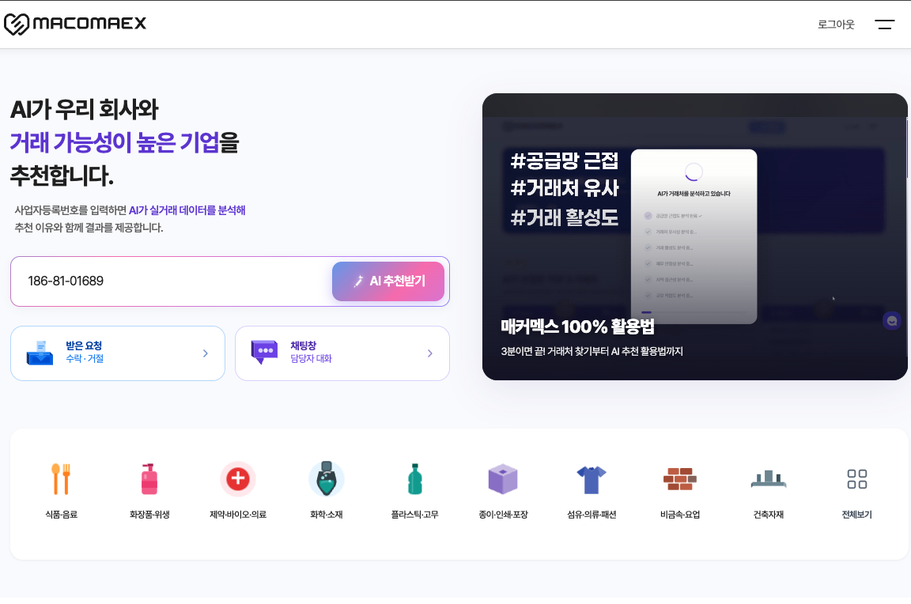
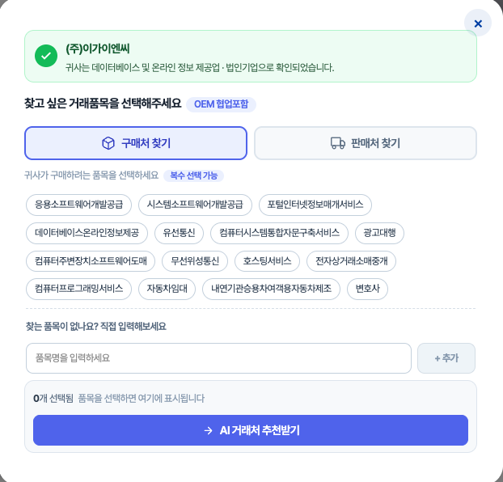
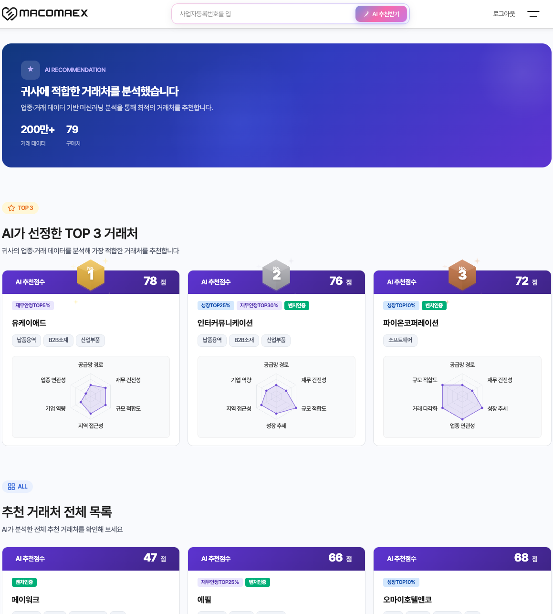
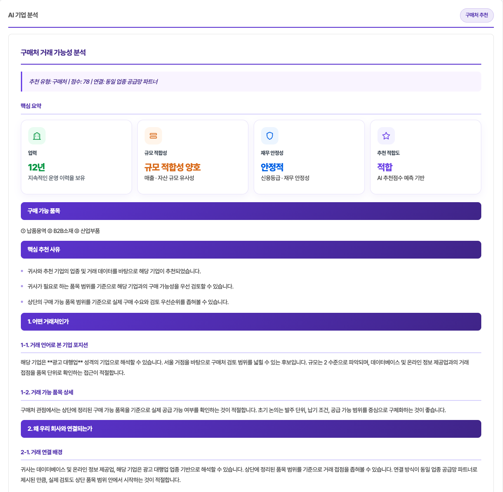
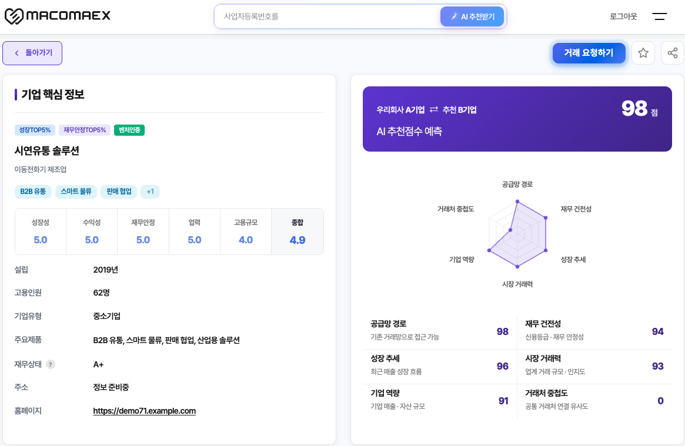
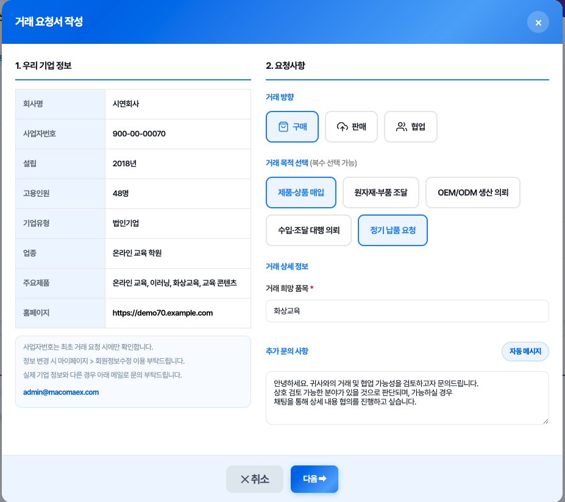
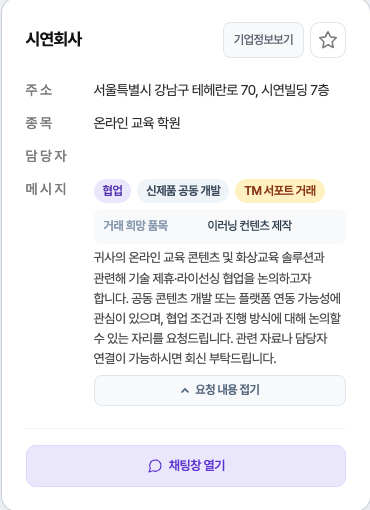
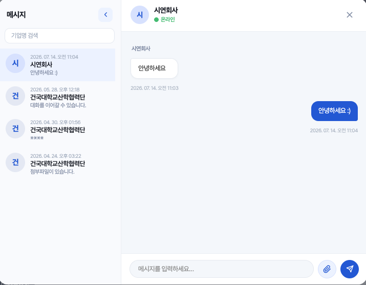

# 매커멕스 (Macomaex)

> 기업 데이터와 AI를 결합한 B2B 거래처 탐색·추천 플랫폼

매커멕스는 사업자등록번호 기반의 기업 정보 조회, 거래처 후보 추천, 기업 간 거래 적합성 분석, 거래 요청 관리를 하나의 흐름으로 연결한다.

## 문제 정의

B2B 거래처 발굴에는 다음과 같은 판단 비용이 수반된다.

- 다수의 후보 기업 중 우선 검토 대상 선정
- 업종, 규모, 재무 상태, 거래 관계를 종합한 적합성 판단
- 탐색 결과를 실제 접촉과 거래 요청으로 연결하는 운영 과정

매커멕스는 기업 데이터와 추천 결과를 결합해 후보 탐색부터 상세 검토, 관심기업 관리, 거래 요청까지의 경로를 제공한다.

## 서비스 흐름

```text
[사업자등록번호 입력]
          |
          v
[기업 식별 및 기업 정보 조회]
          |
          v
[업종·품목·기업 특성 기반 추천 조건 구성]
          |
          v
[구매처·판매처 후보 추천 및 점수화]
          |
          v
[기업 상세·거래 적합성 분석]
          |
          v
[관심기업 등록 또는 거래 요청]
          |
          v
[수신 기업 알림 메일 발송]
          |
          v
[수신 기업의 거래 요청 수락]
          |
          v
[채팅방 연결]
```

### 기업 조회와 추천 조건 설정





## 핵심 기능

- **기업 식별 및 조회** — 사업자등록번호와 KED 기업 식별 코드(KEDCD) 기반의 기업 정보 탐색
- **양방향 거래처 추천** — 구매처와 판매처 관점의 추천 요청을 분리해 병렬 처리
- **추천 조건 반영** — 업종, 소재지, 규모, 주요 품목, 매출, 자산, 부채, 설립일, 거래처·공급처 이름을 추천 요청에 반영
- **추천 결과 탐색** — 상위 추천 기업, 목록, 추천 점수, 기업 상세 정보 제공
- **AI 심층 분석 보고서** — 기업 쌍의 거래 적합성, 거래 가능 품목, 공급망 적합성, 재무·안정성 관점, 초기 접촉 제안 제공
- **거래 전환 관리** — 관심기업, 거래 요청, 수신 기업 알림 메일, 수락 알림, 채팅방 연결, 크레딧 사용 이력 관리
- **유료 기능 운영** — 크레딧 충전 및 KG이니시스 결제 연동

## 데이터 구성

### KODATA 기업 데이터

KODATA 연동 데이터는 기업의 식별·기본 정보와 재무·주식 정보를 서비스 데이터 모델로 정규화한다.

| 범주 | 주요 데이터 항목 |
| --- | --- |
| 기업 식별 | KEDCD, 사업자등록번호(BZNO), 국문·영문 기업명 |
| 기업 기본 정보 | 업종 코드, 설립일, 기업 유형, 소재지, 홈페이지 |
| 인력·규모 | 종업원 수, 기업 규모 정보 |
| 재무 | 결산일, 매출액, 자산, 부채 등 연도별 재무 정보 |
| 주식 | 발행주식 수, 보통주·우선주 합계 |
| 파생 지표 | 성장성, 수익성, 안정성, 업력, 고용, 종합 점수 |

기업 정보 동기화 과정은 원본 응답의 식별값·기업명·형식 검증을 거치며, 유효하지 않은 응답과 식별값 불일치를 저장 대상에서 제외한다.

### 데이터 정규화·적재 파이프라인

KODATA 원문 응답은 서비스 화면에서 바로 사용하지 않고, 기업·재무·주식의 세 데이터셋으로 분리해 정규화한다.

```text
KODATA 원문 응답
       |
       +-- 기업 개요 → company
       |     KEDCD, 사업자등록번호, 기업명, 업종, 규모, 소재지, 연락처 등
       |
       +-- 재무 정보 → company_financial
       |     최근·직전·직직전 결산일별 자산, 자본 관련 항목, 매출, 손익 관련 항목
       |
       +-- 주식 정보 → company_stock
             기준일별 발행주식 수, 보통주·우선주 합계
```

- 숫자형 데이터의 쉼표·빈 값 정규화
- 단일 객체와 배열 형태의 원본 응답을 동일한 행 구조로 변환
- 최근 재무 행의 매출액을 기업 기본 레코드에 동기화
- 사업자등록번호와 KEDCD 형식 검증, 기업명 공백 검증, 허용된 KODATA 원문 출처 검증
- 기업 기본 정보·재무·주식 적재 단위의 성공 여부와 통계 기록

## AI·ML 구성

### 거래처 추천 서비스

추천 서비스는 웹 애플리케이션과 분리된 외부 ML API로 구성된다. PHP API 레이어가 추천 조건을 정규화해 외부 `/recommend` 엔드포인트로 전달하고, 구매처(`trade_type=1`)와 판매처(`trade_type=2`) 요청을 병렬 처리한다.

추천 입력 특성은 다음과 같다.

| 분류 | 입력 특성 |
| --- | --- |
| 기업 식별 | KEDCD |
| 산업·지역 | 업종 코드, 시도 |
| 기업 규모·연혁 | 규모 구간, 설립일, 종업원 관련 정보 |
| 재무 | 최근 매출, 전기 매출, 자산, 부채 |
| 거래 맥락 | 주요 품목, 고객사·공급사 후보 이름 |
| 리스크 신호 | 부실 관련 건수 |

추천 모델의 학습 알고리즘·가중치·학습 데이터는 외부 ML 서비스에 분리되어 있으며, 본 공개 저장소에는 포함하지 않는다. 운영 모델명과 성능 지표는 검증·승인된 정보만 공개 문서에 반영한다.



### ML·LLM 엔드투엔드 데이터 흐름

추천 목록 생성과 상세 분석은 하나의 AI 기능처럼 보이지만, AWS EC2 기반 ML 추천 API와 Gemini 기반 LLM 분석 API가 순차적으로 분리된 구조다.

```text
[1. 사업자등록번호 입력]
          |
          v
[2. KODATA 기업 조회·검증]
  - 최근 KODATA 캐시 우선 조회
  - 미존재 시 실시간 기업 조회
  - 사업자등록번호·KEDCD·기업명 검증
          |
          v
[3. 추천 Feature Payload 생성]
  - KEDCD, 업종, 지역, 규모, 설립일
  - 매출·자산·부채, 주요 품목
  - 고객사·공급사 후보, 리스크 신호
          |
          v
[4. AWS EC2 ML 추천 API 호출]
  - HTTPS 기반 외부 `/recommend` 요청
  - 구매처와 판매처 후보군 별도 요청
          |
          v
[5. ML 추천 응답 정규화·저장]
  - 후보 기업 식별값·순위·AI 추천점수
  - 추천 연결 유형(candidate_type)·레이더 축 점수
  - 추천 이력·응답 캐시 저장
          |
          v
[6. 추천 기업 카드 렌더링]
  - 내부 기업 DB의 업종명·키워드·뱃지 보강
  - 추천점수·레이더·기업 상세 링크 표시
          |
          v
[7. 추천 기업 상세 선택]
          |
          v
[8. Gemini LLM 심층 분석]
  - 기준 기업·후보 기업·ML 점수·레이더·재무 메타 전달
  - 정해진 프롬프트와 JSON 스키마로 분석 리포트 생성
```

| 구간 | 책임 | 주요 입출력 |
| --- | --- | --- |
| KODATA 조회 | 기업 데이터 식별·검증 | 사업자등록번호 → KEDCD 및 기업·재무 기본 정보 |
| Feature Payload | 추천 요청 데이터 구성 | 기업·재무·거래 특성 → ML API 요청 본문 |
| AWS EC2 ML API | 후보 탐색·순위화·다축 점수화 | Feature Payload → 추천 기업 목록, 점수, 레이더, 연결 유형 |
| 웹 애플리케이션 | 결과 정규화·캐시·표시 | ML 응답 → 추천 기업 카드 |
| Gemini LLM | 추천 근거의 자연어 심층 분석 | 기준/후보 기업 및 ML 메타 → 구조화된 분석 리포트 |

KODATA는 기준 기업의 사실 데이터를 제공하고, AWS EC2 ML API는 후보 기업의 우선순위와 다축 추천 지표를 생성하며, Gemini LLM은 그 결과를 거래 검토에 활용할 수 있는 설명형 리포트로 확장한다.

### LLM 기반 심층 분석

추천 이후의 기업 쌍 분석은 Google Gemini 기반 LLM 계층에서 구조화된 JSON 응답으로 생성한다. 분석 항목에는 거래 관계, 추천 근거, 거래 가능 품목, 공급망 적합성, 거래 시나리오, 안정성·재무 관점, 초기 접촉 제안과 유의사항이 포함된다.

| 항목 | 구성 |
| --- | --- |
| 운영 제공자 | Google Gemini API |
| 운영 모델 | `gemini-3-flash-preview` |
| 모델 설정 | `LLM_PROVIDER=gemini`, `GEMINI_MODEL=gemini-3-flash-preview` |
| 호출 방식 | Google Generative Language API `v1beta`의 `generateContent` 엔드포인트 |
| 출력 형식 | JSON 스키마 기반의 구조화된 분석 보고서 |
| 생성 제어 | Temperature 0.1, 최대 출력 6,000 토큰 |
| 신뢰성 처리 | 연결·HTTP 오류 기록, 일시 오류 재시도, 성공 분석 결과 캐시 |
| 이용 제어 | 사용자·기업 쌍·거래 유형 기준 중복 호출 제어 및 크레딧 처리 |

OpenAI 호환 Chat Completions 경로는 향후 모델 교체를 위한 폴백 코드로 유지하며, 현재 운영 LLM 제공자로 사용하지 않는다. 모델 변경 시 위 운영 모델·설정 항목을 함께 갱신한다.



## 점수 체계와 시각화

매커멕스의 점수는 기업 자체의 상태를 나타내는 **기업 평가 점수**와 기준 기업-추천 기업 간 관계를 나타내는 **AI 추천 점수**로 구분된다. 두 점수는 동일한 척도나 동일한 산식이 아니다.

### 1. 기업 평가 점수: 5점 척도

기업 상세·목록 영역의 5각 레이더와 종합 점수는 `company_score_final_dedup` 데이터셋의 점수를 사용한다.

| 지표 | 저장 필드 | 표시 범위 |
| --- | --- | --- |
| 성장성 | `growth_score_5` | 0~5점 |
| 수익성 | `profit_score_5` | 0~5점 |
| 재무 안정성 | `stability_score_5` | 0~5점 |
| 업력 | `age_score_5` | 0~5점 |
| 고용 규모 | `emp_score_5` | 0~5점 |
| 종합 | `final_total_score_5` | 0~5점 |

- 화면 표시 전 모든 개별 지표를 0~5 범위로 보정
- 종합 점수는 우선적으로 `final_total_score_5`를 표시
- 종합 점수가 없는 경우에만 5개 개별 지표의 산술평균을 화면 보조값으로 사용
- 개별 지표의 원천 산식·가중치는 이 공개 저장소에 포함되지 않은 데이터 산출 영역으로 관리

### 2. AI 추천점수 예측: 100점 척도

AI 추천점수는 입력 기업과 후보 기업의 거래 적합도를 외부 ML 추천 서비스가 반환하는 점수다. 웹 애플리케이션은 이를 순위·카드·상세 화면에서 일관되게 보여 주기 위해 다음 표시 규칙을 적용한다.

| 단계 | 처리 규칙 |
| --- | --- |
| 모델 출력 | `display_score` 우선 사용 |
| 대체 규칙 | `display_score`가 없고 `score`가 0~1 확률값이면 `score × 100`으로 변환 |
| 범위 보정 | 0 미만은 0, 100 초과는 100으로 제한 |
| 카드 표시 | 정수 단위 반올림 |
| 상세 적합도 | ML 점수 우선 표시; 부재 시 레이더 축 평균을 보조값으로 사용 |

따라서 AI 추천점수는 신용등급이나 계약 성사 확률을 보증하는 값이 아니라, 입력 특성과 거래 관계 특성을 기반으로 후보 간 우선순위를 나타내는 추천 지표다.

### 3. AI 레이더 점수: 추천 근거의 다축 표현

외부 ML 추천 서비스는 후보별 `radar` 객체로 0~100 범위의 세부 축 점수를 반환한다. 웹 계층은 키 이름을 표준화하고 0~100 범위로 보정한 뒤, 최대 6개 축을 선택해 육각형과 막대 형태로 표시한다.

| 표준 축 | 화면상 의미 |
| --- | --- |
| 공급망 경로 | 기존 거래망 또는 업종 네트워크 기반 연결성 |
| 거래처 중첩도 | 공통 거래처·거래망 유사도 |
| 재무 건전성 | 신용·재무 안정성 관련 특성 |
| 시장 거래력 | 업계 거래 규모·시장 영향 관련 특성 |
| 거래 다각화 | 거래처 집중도와 거래 분산 관련 특성 |
| 규모 적합도 | 매출·자산 등 기업 규모의 적합성 |
| 기업 역량 | 기업 매출·자산 규모 관련 특성 |
| 지역 접근성 | 물류·방문 접근성 관련 특성 |
| 업종 연관성 | 업종 코드의 유사성·연관성 |
| 거래 지속성 | 평균 거래 유지 기간 관련 특성 |
| 품목 보완성 | 품목 간 상호 보완 관계 |
| 성장 추세 | 최근 매출 성장 흐름 |

육각형의 축 선택·배치는 다음 규칙을 따른다.

1. `공급망 경로`, `거래처 중첩도`, `재무 건전성`을 우선 축으로 고정한다. 거래처 중첩도가 0점 이하이면 고정 축에서 제외한다.
2. 나머지 축은 점수 내림차순으로 선택한다.
3. 화면에는 최대 6개 축을 표시한다. 데이터가 부족하면 정해진 보조 축을 0점으로 채운다.
4. 도형은 가독성을 위해 25점 단위로 반올림하고, 최저 표시 반경을 25점으로 보정한다. 막대와 범례에는 보정 전 0~100 점수를 표시한다.

이 육각형은 모델의 별도 산출물이 아니라, ML 서비스가 반환한 다축 점수를 비교하기 위한 시각화다. 즉, 육각형의 넓이 자체를 거래 성사 확률이나 별도의 총합 점수로 해석하지 않는다.

### 4. 공급망 경로와 추천 연결 유형

`candidate_type`은 후보가 추천된 거래 관계의 유형을 나타내는 메타데이터다. 화면과 LLM 분석에서 다음과 같은 방식으로 해석한다.

| 유형 | 해석 |
| --- | --- |
| `chain*` | 공통 거래처 네트워크를 통한 연결 |
| `partner*` | 동종 기업의 실거래 기반 파트너 연결 |
| `industry` | 동일 업종 공급망 파트너 |
| `neighbor` | 지역 기반 근접 파트너 |

공급망 경로는 위 연결 유형, 거래망·업종·품목 관련 레이더 특성, LLM 심층 분석의 `supply_chain_fit` 설명을 함께 확인하는 근거다. 단일 축이나 하나의 점수만으로 실제 거래 관계를 단정하지 않는다.



## 거래 요청과 채팅 연결

추천 기업을 검토한 뒤 거래 방향·희망 품목·문의 내용을 입력해 거래 요청을 보낸다. 수신 기업이 요청을 수락하면 요청자에게 알림이 전달되고, 두 기업이 참여하는 채팅방이 연결된다.







## 시스템 구성

```text
사용자
  |
  v
매커멕스 웹 애플리케이션
(PHP · 그누보드 · Prix 테마)
  ├── MySQL
  ├── KODATA 기업 데이터
  ├── AWS EC2 ML 추천 API
  ├── Gemini LLM 분석 API
  ├── GetStream Chat
  └── KG이니시스 결제
```

## 기술 스택

| 영역 | 기술 및 구성 |
| --- | --- |
| 애플리케이션 | PHP, 그누보드 |
| 프런트엔드 | Prix 테마, HTML, CSS, JavaScript |
| 데이터베이스 | MySQL |
| 기업 데이터 | KODATA 연동, SFTP 기반 데이터 수신 |
| 추천 | 외부 ML 추천 API, 구매·판매 추천 병렬 호출 |
| 심층 분석 | Google Gemini API (`gemini-3-flash-preview`) |
| 거래 커뮤니케이션 | GetStream Chat 기반 채팅 채널 동기화 |
| 결제 | KG이니시스, 크레딧 원장 관리 |
| 의존성 관리 | Composer, phpseclib |
| 검증 | PHP 기반 KODATA 동기화·읽기 전용 경로·계약 테스트 |

## 저장소 구성

```text
www/
├── theme/prix/       # 사용자 화면 테마와 프런트엔드 자산
├── api/              # 기업 조회·추천 API 프록시
├── ko/               # 기업 목록, 상세, 추천, 마이페이지 화면과 분석 API
├── lib/              # 기업 데이터·거래·공통 라이브러리
├── payment/          # 결제 처리 모듈
├── toss/             # 토스 결제 연동 관련 리소스
├── backoffice/       # 관리자 기능
├── tests/            # KODATA 동기화 관련 테스트
└── install/          # 설치 및 데이터베이스 스키마
```
